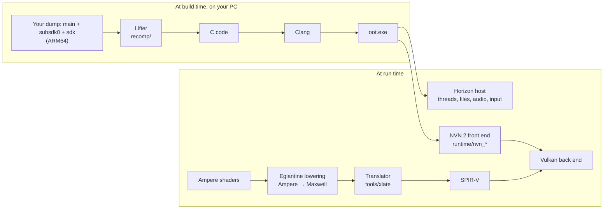

# OoT Recomp

[](LICENSE)

**OoT Recomp** is a static recompilation of *The Legend of Zelda: Ocarina of Time* for Nintendo Switch 2, update 1.1.1, into a native Windows x86-64 application with a Vulkan renderer. There is no emulator at
run time: the game's ARM64 code is translated to C ahead of time and compiled into one executable, `oot.exe`, and its
graphics calls are answered by a host implementation of NVN 2.

This fork is [philneitz/oot-pc-recomp](https://github.com/philneitz/oot-pc-recomp), branch `oot/merged`. It is based on
[Chiuauaa/oot-pc-recomp](https://github.com/Chiuauaa/oot-pc-recomp) and brings together what its sibling projects found
(see [Where this comes from](#where-this-comes-from)).

> [!IMPORTANT]
> **No game files are included, and none ever will be.** You need your own copy of the game, dumped from your own
> console. Instructions for obtaining those files will not be provided. There are no downloadable builds: everyone
> builds from their own dump.

## Status

**Early, and not complete.** So far it has been run on one PC with an NVIDIA GPU on Windows, in the opening
scenes. Other parts of the game and other GPUs are untested on this branch. It restores translator patches 0022 and
0023, which froze a GTX 1070 on entering the world in the port it is based on.

Working there:

- Boot, title screen, the intro movie and its speech, the save, and walking around the world with a controller.
- World picture without the white flicker and the holes in colour draws (render conditions on samples-passed reports).
- Colours, HUD and the depth chain at half resolution.

Open, most visible first:

- **A grey veil from the fog pass**, and indirect light that looks flat next to the original. The cause is not known yet.
- **Mesh draws are not replayed** (about 36 calls a frame in the first scene), which is probably why the gate and thick
  moss in Link's house are missing.
- **Frame rate:** about 45 fps on that GPU since the last compute programs were enabled, down from about 60.
- **Camera jumps under GPU backlog:** `OOT_GPU_SYNC=1` stops them in the logs. It is a stopgap, and its cost is not
  measured yet.
- **No neural upscaler:** a linear blit stands in for it, so the picture is softer than on the console.
- A crash in the first seconds on about a third of starts. Restarting works; the cause is open.

Findings as they come in: [docs/oot-status.md](docs/oot-status.md) and
[docs/oot-rendering-investigation.md](docs/oot-rendering-investigation.md).

## How it works



The longer version is in [docs/architecture.md](docs/architecture.md).

## Building from source

The toolchain is the one TotK Recomp uses ([docs/building.md](docs/building.md)): Clang, Ninja, Python 3.12 and the .NET
SDK for the shader translator. With the ExeFS and RomFS of update 1.1.1 from your own dump:

```
.venv\Scripts\python tools\build_xlate.py
.venv\Scripts\python recomp\gen.py --exefs <exefs> --out generated\oot111 --modules main,subsdk0,sdk --patches recomp\patches-oot111.txt
.venv\Scripts\python tools\build_game.py --version oot111 --expected tools\data\expected-oot111.json --exefs <exefs> --romfs <packed romfs>
```

After a translator build, copy `totk_xlate.exe` and `totk_xlate.id` from `build\xlate` next to `oot.exe`. A new
translator also invalidates the shader cache, so the first entry into the world takes several minutes again.

Everything the build writes stays under `build\` and `generated\`, which git ignores. Plan for at least 32 GB of RAM:
the test runs peaked at about 22 GB.

Some names still say `totk` or `DKB`, such as `totk.ini`, `TOTK_*` and `DKB_*` variables and `totk_xlate`. They are kept
on purpose, so that merges from the upstream projects stay simple.

### Test switches

| Variable | Effect |
| --- | --- |
| `OOT_GPU_SYNC=1` / `=2` | Wait for the GPU at each present / each submit. |
| `OOT_SKIP_STAGE=<hash>` | Drop draws of a program with this NVN 2 stage, to see what a pass adds. |
| `OOT_CAM_LOG=<file>` | Log which camera each submission binds. |
| `OOT_OCC_LOG=<file>` | Log samples-passed reports in a window of frames. |
| `OOT_OCC_FORCE=<n>`, `OOT_OCC_HOLD=<n>` | Older occlusion tests. |
| `OOT_MESH_LOG=1` | Count mesh draws and name their programs. |
| `TOTK_DUMP=<frame>`, `TOTK_DUMP_TRIGGER=<file>` | Write a frame dump, at a frame number or when the file appears. |

## Contributing

Read [CONTRIBUTING.md](CONTRIBUTING.md) first. Its hard rule: nothing that came out of the game goes into the repository,
not in commits, issues or pull requests. Run `python tools/check_content.py --staged` before committing; CI runs the
same check. Everyone taking part follows the [code of conduct](CODE_OF_CONDUCT.md).

## Where this comes from

This project stands on the work of others, and much of its code came from them unchanged:

- **[TotK Recomp](https://github.com/valentderah/totk-pc-recomp)** by valentderah, for *Tears of the Kingdom*: the
  lifter, the Horizon host and the NVN and Vulkan runtime.
- **[DKB Recomp](https://github.com/Lucas-blip-png/dkb-pc-recomp)** by Lucas-blip-png, for *Donkey Kong Bananza*: the step
  to Switch 2, with NVN 2, Ampere shaders and the Switch 2 services. philneitz contributes there as well, and fixes from
  that work are merged here. Its plan and notes are kept as history in
  [docs/bananza-plan.md](docs/bananza-plan.md), [docs/bananza-shaders.md](docs/bananza-shaders.md) and
  [docs/dkb-testing.md](docs/dkb-testing.md); the DKB build path (`dkb100`) is still in the tree.
- **[Chiuauaa/oot-pc-recomp](https://github.com/Chiuauaa/oot-pc-recomp)**: the Ocarina of Time port this fork is based
  on, with Zuriel-Zurichi's rendering work.
- **[Lichii](https://github.com/zortos293/Lichii)** by zortos293 and
  **[Eglantine](https://git.eden-emu.dev/Franseven/PokeDinner-a-Eglantine-Fork)** (Eden Emulator Project): the
  Ampere-to-Maxwell shader lowering and many findings about this game.
- [Mesa NAK](https://gitlab.freedesktop.org/mesa/mesa) for the SM70+ encodings,
  [LAS Recomp](https://github.com/peiikai/LASRecomp), [MacNativeGames](https://github.com/ly05010419/MacNativeGames),
  [nxnative](https://github.com/seedds/nxnative), [SavageWindRecomp](https://github.com/Revivedx/SavageWindRecomp),
  [Ryujinx](https://github.com/Ryujinx/Ryujinx), [deko3d](https://github.com/devkitPro/deko3d),
  [hactool](https://github.com/SciresM/hactool), [Switchbrew](https://switchbrew.org) and the rest listed in
  [THIRD_PARTY_NOTICES.md](THIRD_PARTY_NOTICES.md).

Most of the code and documentation here is written by AI coding agents (Claude Code), as in the projects above, and
checked by running the game.

## License

OoT Recomp as a whole is under the [GNU GPL v3 or later](LICENSE), because it includes Eglantine's GPL Ampere shader
lowering (`runtime/third_party/eglantine/`). The files that came from TotK Recomp keep their
[MIT License](LICENSE-MIT); third-party code keeps its own license ([THIRD_PARTY_NOTICES.md](THIRD_PARTY_NOTICES.md)).
The license grants nothing for Nintendo's game.

OoT Recomp is an independent, non-commercial fan project, not affiliated with or endorsed by Nintendo. *The Legend of
Zelda: Ocarina of Time* and *Nintendo Switch 2* are trademarks of Nintendo.
