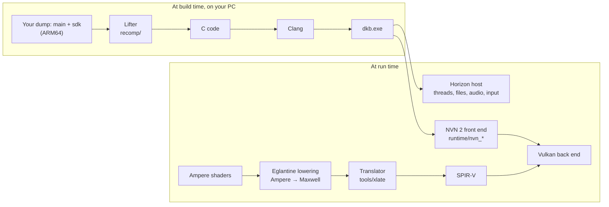

# DKB Recomp

> This checkout's `oot-port` branch contains experimental Ocarina of Time 1.1.1 support. See
> [Ocarina rendering investigation and implementation plan](docs/oot-rendering-investigation.md) for the current
> build command, upstream branch audit, verified shader corrections and remaining 3D blockers. The Bananza status
> and instructions below describe the inherited base project.

[](LICENSE)
[](https://github.com/Lucas-blip-png/dkb-pc-recomp/actions/workflows/content-guard.yml)
[](https://github.com/Lucas-blip-png/dkb-pc-recomp/stargazers)
[](https://github.com/Lucas-blip-png/dkb-pc-recomp/issues?q=is%3Aopen+label%3A%22help+wanted%22)
[](https://github.com/Lucas-blip-png/dkb-pc-recomp/discussions)
[](https://ko-fi.com/lucasblippng)

**DKB Recomp** is a static recompilation of *Donkey Kong Bananza* (Nintendo Switch 2, 2025) into a native Windows
x86-64 application with a Vulkan renderer. There is no emulator at run time: the game's ARM64 code is translated to C
ahead of time and compiled into one executable, and its graphics calls are answered by a host implementation of
NVN 2. It is built on [TotK Recomp](https://github.com/valentderah/totk-pc-recomp), which does the same for *Tears of
the Kingdom* on the original Switch.

As far as we know, no other static recompilation of a Switch 2 game is public.

> This is a community fork of [Lucas-blip-png/dkb-pc-recomp](https://github.com/Lucas-blip-png/dkb-pc-recomp),
> created by Lucas-blip-png. The upstream history, original contributor credits and license notices are preserved.
> This fork adds Linux build support and Linux-specific fixes.

> [!IMPORTANT]
> **No game files are included, and none ever will be.** You need your own copy of *Donkey Kong Bananza*, dumped
> from your own console. Instructions for obtaining those files will not be provided. There are no downloadable
> builds: everyone builds from their own dump.

## Status

**Not playable yet.** The game boots, goes through the title screen into the tutorial cave, renders the 3D scene and
answers the controller: you can walk and punch through the mining tunnel, with the guide movies playing, and one
hand-played run reached the Ingot Isle Cave-In section. It still
can crash (on NVIDIA two light quads are skipped to avoid a GPU fault,
[#9](https://github.com/Lucas-blip-png/dkb-pc-recomp/issues/9)), and
many effects are missing.
There is no release. An installer builds the game from your own dump: [docs/installer.md](docs/installer.md).
Progress, day by day: [docs/devlog.md](docs/devlog.md).

| Phase | | State |
| --- | --- | --- |
| F0 CPU | ✅ | `main` and `sdk` (180,061 functions) lift with no unsupported instruction (ARMv8.3 pointer authentication and `LDAPR` added). Differential tests against Unicorn pass. |
| F1 OS | ✅ | Boots on TotK Recomp's Horizon host with the Switch 2 differences: RomFS, save, audio, controller. |
| F2 NVN 2 | ✅ | 700 NVN 2 entry points answered; the game loop runs. 51 new command buffer calls (mesh shaders, VRS, DLSS, push constants…) are accepted but not recorded yet. |
| F3 Shaders | ✅ | All 4,820 Ampere shader stages of the first 3D scene go through Eglantine's Ampere-to-Maxwell lowering and TotK Recomp's translator to SPIR-V. |
| F4 Vulkan | ✅ | The title screen and the tutorial's 3D scene render. |
| F5 Playable | 🚧 | Controller, guide movies (VP9) and push constants work. The native geometry path renders the destructible ground on one Linux GTX 1070; destruction and other GPUs still need validation. Open: a GPU fault some minutes in on NVIDIA, some textures, and performance outside the tutorial. See [#45](https://github.com/Lucas-blip-png/dkb-pc-recomp/issues/45). |

The plan, phase by phase: [docs/bananza-plan.md](docs/bananza-plan.md). What is open right now:
[Roadmap to playable](https://github.com/Lucas-blip-png/dkb-pc-recomp/issues/10).

## How it works



The longer version is in [docs/architecture.md](docs/architecture.md) (shared with TotK Recomp) and
[docs/bananza-shaders.md](docs/bananza-shaders.md) (the NVN 2 shader work).

## How to help

Each open problem is a separate, well-bounded job with its own issue. Pick one, say in the issue that you are on it,
and keep each pull request to one topic. Issues labelled
[`in progress`](https://github.com/Lucas-blip-png/dkb-pc-recomp/issues?q=is%3Aopen+label%3A%22in+progress%22) are
already taken, and the top of the [roadmap](https://github.com/Lucas-blip-png/dkb-pc-recomp/issues/10) says what is
being worked on right now.

**No code needed**, only your PC and your own copy of the game:

- [#3](https://github.com/Lucas-blip-png/dkb-pc-recomp/issues/3) **Test on your GPU.** Everything so far was checked
  on one NVIDIA card. Runs on AMD, Intel and other NVIDIA cards, with logs, show what breaks there.
- [#7](https://github.com/Lucas-blip-png/dkb-pc-recomp/issues/7) **Play past the tutorial** and report where it stops.
- [#9](https://github.com/Lucas-blip-png/dkb-pc-recomp/issues/9) **The GPU fault after the first guide movie**: seen
  on three NVIDIA drivers (617.14, 617.42, 621.01); runs on AMD and Intel would show whether it is NVIDIA's.

**Code** ([help wanted](https://github.com/Lucas-blip-png/dkb-pc-recomp/issues?q=is%3Aopen+label%3A%22help+wanted%22)):

- [#5](https://github.com/Lucas-blip-png/dkb-pc-recomp/issues/5) **Checkerboard textures** on some rock surfaces. The Switch 2 GOB layout (f4f7b17) fixes the gold rock in the tutorial cave; the other surfaces still need a check.
- [#6](https://github.com/Lucas-blip-png/dkb-pc-recomp/issues/6) **NVN 2 calls not recorded yet**: mesh shaders, VRS,
  DLSS and others.
- **Symbols.** Function names help debugging. They come from
  [GRAnimated/DKBananza](https://github.com/GRAnimated/DKBananza), which welcomes contributions too.

Your first contribution, step by step:

1. Build from your own dump ([Building from source](#building-from-source)).
2. Run it as in [docs/dkb-testing.md](docs/dkb-testing.md) and note how far it gets on your machine.
3. Report it on #3 or #7, or pick an issue above.

Before you open a pull request, read [CONTRIBUTING.md](CONTRIBUTING.md). Its hard rule: nothing that came out of the
game goes into the repository, not in commits, issues or pull requests. Run `python tools/check_content.py --staged`
before committing; CI runs the same check. Questions go to
[Discussions](https://github.com/Lucas-blip-png/dkb-pc-recomp/discussions). Everyone taking part follows the
[code of conduct](CODE_OF_CONDUCT.md).

## Support the project

If you want to support the work without writing code, tips go to
[ko-fi.com/lucasblippng](https://ko-fi.com/lucasblippng). A tip pays for time on the project; it buys no game files,
builds or early access, and everything stays open source here. Starring the repository and sharing it with people who
know GPUs, ARM64 or the Switch also helps.

## Building from source

The toolchain is TotK Recomp's ([docs/building.md](docs/building.md)): MSYS2 UCRT64 Clang, Ninja, Python 3.12 and the
.NET SDK for the shader translator. With the Bananza ExeFS and RomFS from your own dump:

```
.venv\Scripts\python tools\build_xlate.py
.venv\Scripts\python recomp\gen.py --exefs <exefs> --out generated\dkb100 --modules main,sdk --patches recomp\patches-dkb100.txt
.venv\Scripts\python tools\dkb_expected.py --exefs <exefs> --name dkb100 --display 1.0.0
.venv\Scripts\python tools\dkb_pack_romfs.py --dir <romfs folder> --out build\extracted\dkb100\romfs
.venv\Scripts\python tools\build_game.py --version dkb100 --expected tools\data\expected-dkb100.json --exefs <exefs> --romfs build\extracted\dkb100\romfs
```

Everything the build writes stays under `build\` and `generated\`, which git ignores. The game uses about 13 GB of
RAM, so 16 GB is the minimum for now. Running and testing: [docs/dkb-testing.md](docs/dkb-testing.md).

## FAQ

**Can I play it?** Not yet. It reaches the tutorial and crashes often. Follow the
[roadmap](https://github.com/Lucas-blip-png/dkb-pc-recomp/issues/10) or the [devlog](docs/devlog.md).

**Will there be a download?** No. The executable is made from the game's own code, so it cannot be shared. Everyone
builds it from their own dump; the installer does this for you ([docs/installer.md](docs/installer.md)).

**Which version of the game?** Base 1.0.0. Update 458752 has a different layout and is not supported yet.

**Linux?** The runtime, lifter and build scripts are portable and the runtime, shader translator and game build on x86-64 Linux; [linux/README.md](linux/README.md) has the Bananza-specific steps. A Linux run on an NVIDIA GTX 1070 reached the tutorial, and the native geometry path fixes the black destructible terrain. Other GPUs and longer play sessions still need testing.

**Why GPL?** The shader lowering comes from Eglantine (Eden Emulator Project), which is GPL. Files that came from TotK
Recomp keep their MIT terms.

**How is AI used?** Most of the code and documentation is written by AI coding agents (Claude Code), as in TotK
Recomp, and checked by running the game and the differential tests. AI-assisted pull requests are welcome; you are
responsible for having read and run them.

## Credits

- [TotK Recomp](https://github.com/valentderah/totk-pc-recomp) by valentderah, the base of everything here, and the
  projects it builds on: [LAS Recomp](https://github.com/peiikai/LASRecomp),
  [MacNativeGames](https://github.com/ly05010419/MacNativeGames), [nxnative](https://github.com/seedds/nxnative),
  [SavageWindRecomp](https://github.com/Revivedx/SavageWindRecomp), [Ryujinx](https://github.com/Ryujinx/Ryujinx),
  [deko3d](https://github.com/devkitPro/deko3d), [hactool](https://github.com/SciresM/hactool) and the rest listed in
  [THIRD_PARTY_NOTICES.md](THIRD_PARTY_NOTICES.md).
- [GRAnimated/DKBananza](https://github.com/GRAnimated/DKBananza) for the game's symbols and research.
- [Eglantine](https://git.eden-emu.dev/Franseven/PokeDinner-a-Eglantine-Fork) (Eden Emulator Project) for the
  Ampere-to-Maxwell shader lowering and its Switch 2 notes, and [Mesa NAK](https://gitlab.freedesktop.org/mesa/mesa)
  for the SM70+ encodings both build on.
- [libvpx](https://chromium.googlesource.com/webm/libvpx) for the movies.
- [Switchbrew](https://switchbrew.org) for the Switch 2 `GetInfo` ids, and the Switch homebrew community.

## License

DKB Recomp as a whole is under the [GNU GPL v3 or later](LICENSE), because it includes Eglantine's GPL Ampere shader
lowering (`runtime/third_party/eglantine/`). The files that came from TotK Recomp keep their
[MIT License](LICENSE-MIT); third-party code keeps its own license ([THIRD_PARTY_NOTICES.md](THIRD_PARTY_NOTICES.md)).
The license grants nothing for Nintendo's game.

DKB Recomp is an independent, non-commercial fan project, not affiliated with or endorsed by Nintendo. *Donkey Kong
Bananza* and *Nintendo Switch 2* are trademarks of Nintendo.
